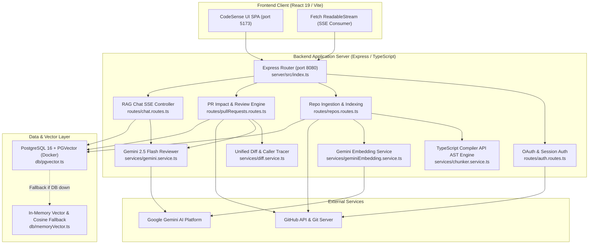
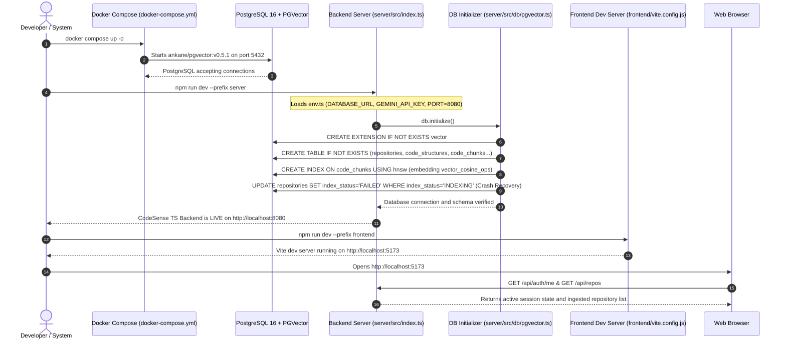
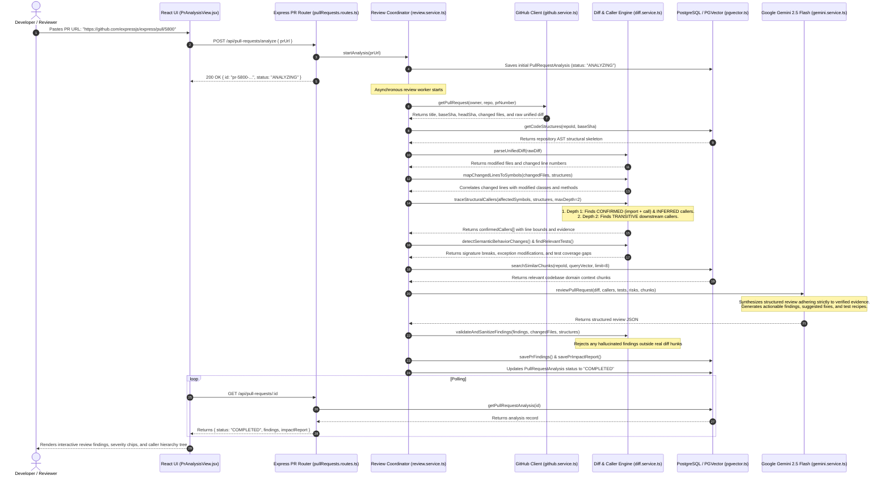

# CodeSense — Complete Project Codebase Map & Architectural Guide

Welcome to the definitive architectural map and developer guide for **CodeSense** (also referred to historically as *devPilot*). 

CodeSense is an **AI-powered Codebase Comprehension and Pull Request Review Copilot** that combines deterministic Abstract Syntax Tree (AST) static analysis with Google Gemini vector embeddings and PostgreSQL PGVector storage.

---

## 📚 Complete Codebase Training Curriculum (`docs/codebase-guide/`)

The repository includes a 13-module comprehensive training curriculum located in [`docs/codebase-guide/`](file:///c:/Users/KARAN%20BISHT/OneDrive/Desktop/backend/docs/codebase-guide):

| Module | Title | Primary Topics Covered |
| :--- | :--- | :--- |
| **[Module 01](file:///c:/Users/KARAN%20BISHT/OneDrive/Desktop/backend/docs/codebase-guide/01-architecture.md)** | **System Architecture & Topology** | What CodeSense does, developer problem statement, dual-engine hybrid architecture, tech stack, and component interactions. |
| **[Module 02](file:///c:/Users/KARAN%20BISHT/OneDrive/Desktop/backend/docs/codebase-guide/02-project-structure.md)** | **Project Structure & Entry Points** | Full directory tree, active Node.js server vs legacy Spring Boot prototype, entry points (`index.ts`, `main.jsx`), and config files. |
| **[Module 03](file:///c:/Users/KARAN%20BISHT/OneDrive/Desktop/backend/docs/codebase-guide/03-authentication.md)** | **Authentication, OAuth & Sessions** | GitHub OAuth 2.0 flow, CSRF state verification, signed cookies (`codesense_session`), demo login, session storage, and logout. |
| **[Module 04](file:///c:/Users/KARAN%20BISHT/OneDrive/Desktop/backend/docs/codebase-guide/04-repository-indexing.md)** | **Repository Ingestion & Indexing** | URL validation, git clone/fetch without shell injection, file crawling, AST skeleton vs vector storage, and startup crash recovery. |
| **[Module 05](file:///c:/Users/KARAN%20BISHT/OneDrive/Desktop/backend/docs/codebase-guide/05-ast-and-chunking.md)** | **AST Parsing & Skeleton Extraction** | ASTs explained from zero, TypeScript Compiler API, Java/Python block scanners, cross-file references, and 50-line sliding window. |
| **[Module 06](file:///c:/Users/KARAN%20BISHT/OneDrive/Desktop/backend/docs/codebase-guide/06-gemini-and-pgvector.md)** | **Gemini Embeddings & PGVector** | `gemini-embedding-2` 768-dim vectors, `batchEmbedContents`, cosine distance `<=>`, HNSW index, and in-memory vector cache fallback. |
| **[Module 07](file:///c:/Users/KARAN%20BISHT/OneDrive/Desktop/backend/docs/codebase-guide/07-rag-chat.md)** | **Architecture Q&A & Streaming Chat** | End-to-end RAG workflow, context budgeting (12k chars), Server-Sent Events (SSE) streaming, citations, and prompt grounding. |
| **[Module 08](file:///c:/Users/KARAN%20BISHT/OneDrive/Desktop/backend/docs/codebase-guide/08-pr-review-and-impact.md)** | **PR Review & Change-Impact Engine** | Unified diff parsing, line-to-AST mapping, downstream callers (`CONFIRMED`, `INFERRED`, `TRANSITIVE`), behavior changes, and Gemini review. |
| **[Module 09](file:///c:/Users/KARAN%20BISHT/OneDrive/Desktop/backend/docs/codebase-guide/09-frontend-and-api.md)** | **Frontend Architecture & API Client** | React 19 SPA, tab routing, central `api.js` client, SSE stream reader, and real backend vs sample exploration data. |
| **[Module 10](file:///c:/Users/KARAN%20BISHT/OneDrive/Desktop/backend/docs/codebase-guide/10-database-schema.md)** | **Database Schema & Relational Model** | Tables (`repositories`, `code_structures`, `code_chunks`, `pull_requests`, `pr_findings`, `pr_impacts`), foreign keys, and indexes. |
| **[Module 11](file:///c:/Users/KARAN%20BISHT/OneDrive/Desktop/backend/docs/codebase-guide/11-security-and-failure-handling.md)** | **Security Controls & Threat Model** | Preventing RCE via `execFile`, path traversal rejection, SQL injection parameterization, prompt injection delimiters, and rate limits. |
| **[Module 12](file:///c:/Users/KARAN%20BISHT/OneDrive/Desktop/backend/docs/codebase-guide/12-verification-and-gaps.md)** | **Verification Audit & Known Gaps** | Comprehensive audit matrix (VERIFIED, PARTIALLY IMPLEMENTED, MOCKED, DOCUMENTED BUT NOT FOUND) and test coverage. |
| **[Module 13](file:///c:/Users/KARAN%20BISHT/OneDrive/Desktop/backend/docs/codebase-guide/13-hackathon-technical-questions.md)** | **Hackathon Defense & Judge Q&A** | 10 anticipated judge questions across architecture, vector math, caller tracing, security, and failure modes with model answers. |

---

## 🗺️ Architectural Diagrams & Workflows

### 1. Overall System Topology

---

### 2. Application Startup Sequence

---

### 3. Pull Request Review & Impact Workflow

---

## 🗂️ Core File & Responsibility Directory

### Backend (`server/src/`):
- [`index.ts`](file:///c:/Users/KARAN%20BISHT/OneDrive/Desktop/backend/server/src/index.ts): Express server configuration, CORS whitelist, route mounting, database initialization, and health check.
- [`config/env.ts`](file:///c:/Users/KARAN%20BISHT/OneDrive/Desktop/backend/server/src/config/env.ts): Environment configuration, Zod defaults, Gemini 768-dim vector settings, rate limits, and allowed origins.
- [`db/pgvector.ts`](file:///c:/Users/KARAN%20BISHT/OneDrive/Desktop/backend/server/src/db/pgvector.ts): PostgreSQL connection pool, schema initialization, HNSW index management, vector distance queries, and crash recovery.
- [`db/memoryVector.ts`](file:///c:/Users/KARAN%20BISHT/OneDrive/Desktop/backend/server/src/db/memoryVector.ts): In-memory vector cache and cosine similarity fallback when PostgreSQL is offline.
- [`middleware/auth.ts`](file:///c:/Users/KARAN%20BISHT/OneDrive/Desktop/backend/server/src/middleware/auth.ts): Signed session cookie verification (`codesense_session`) and authentication guards.
- [`middleware/rateLimit.ts`](file:///c:/Users/KARAN%20BISHT/OneDrive/Desktop/backend/server/src/middleware/rateLimit.ts): In-memory sliding-window rate limiters protecting AI, Auth, and Indexing endpoints.
- [`routes/auth.routes.ts`](file:///c:/Users/KARAN%20BISHT/OneDrive/Desktop/backend/server/src/routes/auth.routes.ts): GitHub OAuth 2.0 handshake, CSRF state verification, demo login, session inspection, and logout.
- [`routes/repos.routes.ts`](file:///c:/Users/KARAN%20BISHT/OneDrive/Desktop/backend/server/src/routes/repos.routes.ts): Repository import endpoint, background indexing trigger, status polling, and AST tree retrieval.
- [`routes/pullRequests.routes.ts`](file:///c:/Users/KARAN%20BISHT/OneDrive/Desktop/backend/server/src/routes/pullRequests.routes.ts): Pull request review trigger, findings retrieval, and change-impact report endpoints.
- [`routes/chat.routes.ts`](file:///c:/Users/KARAN%20BISHT/OneDrive/Desktop/backend/server/src/routes/chat.routes.ts): RAG architecture chat controller streaming tokens via Server-Sent Events (SSE).
- [`services/chunker.service.ts`](file:///c:/Users/KARAN%20BISHT/OneDrive/Desktop/backend/server/src/services/chunker.service.ts): TypeScript Compiler API AST extractor, Java/Python block scanners, cross-file reference resolver, and 50-line sliding-window chunker.
- [`services/diff.service.ts`](file:///c:/Users/KARAN%20BISHT/OneDrive/Desktop/backend/server/src/services/diff.service.ts): Unified git diff parser, line-to-symbol mapper, caller tracer (CONFIRMED vs INFERRED, Transitive Depth 2), behavior change detector, and test finder.
- [`services/geminiEmbedding.service.ts`](file:///c:/Users/KARAN%20BISHT/OneDrive/Desktop/backend/server/src/services/geminiEmbedding.service.ts): Google Generative AI client using `gemini-embedding-2`, 768 dimensions, batchEmbedContents (batch size 64), and exponential backoff retry.
- [`services/gemini.service.ts`](file:///c:/Users/KARAN%20BISHT/OneDrive/Desktop/backend/server/src/services/gemini.service.ts): Gemini 2.5 Flash structured PR reviewer, schema validator, and streaming chat assistant.
- [`services/github.service.ts`](file:///c:/Users/KARAN%20BISHT/OneDrive/Desktop/backend/server/src/services/github.service.ts): Secure Git client using `execFile` without shell spawning, directory traversal validator, and GitHub REST API fetcher.
- [`services/indexer.service.ts`](file:///c:/Users/KARAN%20BISHT/OneDrive/Desktop/backend/server/src/services/indexer.service.ts): Ingestion pipeline orchestrator (cloning -> AST parsing -> Gemini embedding -> PGVector storage).
- [`services/review.service.ts`](file:///c:/Users/KARAN%20BISHT/OneDrive/Desktop/backend/server/src/services/review.service.ts): PR analysis pipeline orchestrator coordinating AST skeletons, diff parsing, caller tracing, PGVector search, and Gemini synthesis.

### Frontend (`frontend/src/`):
- [`main.jsx`](file:///c:/Users/KARAN%20BISHT/OneDrive/Desktop/backend/frontend/src/main.jsx): React 19 bootstrap entry point mounting `<App />` into DOM `#root`.
- [`App.jsx`](file:///c:/Users/KARAN%20BISHT/OneDrive/Desktop/backend/frontend/src/App.jsx): Master state controller, tab switcher (`DASHBOARD`, `REPOS`, `CODE_TREE`, `COMPREHENSION`, `PR_ANALYSIS`), and auth sync.
- [`api.js`](file:///c:/Users/KARAN%20BISHT/OneDrive/Desktop/backend/frontend/src/api.js): Centralized API client encapsulating all fetch endpoints and the SSE `ReadableStream` decoder.
- [`components/Navbar.jsx`](file:///c:/Users/KARAN%20BISHT/OneDrive/Desktop/backend/frontend/src/components/Navbar.jsx): Top navigation bar with active tab indicators, user avatar, demo login button, and logout action.
- [`components/DashboardHome.jsx`](file:///c:/Users/KARAN%20BISHT/OneDrive/Desktop/backend/frontend/src/components/DashboardHome.jsx): Main dashboard showing indexed repository overview, quick actions, and recent reviews.
- [`components/RepoDashboard.jsx`](file:///c:/Users/KARAN%20BISHT/OneDrive/Desktop/backend/frontend/src/components/RepoDashboard.jsx): Repository importer with URL validation, real-time indexing progress bar, and file count stats.
- [`components/CodeTreeVisualizer.jsx`](file:///c:/Users/KARAN%20BISHT/OneDrive/Desktop/backend/frontend/src/components/CodeTreeVisualizer.jsx): Interactive AST explorer displaying classes, methods, imports, and file line ranges.
- [`components/RepoComprehension.jsx`](file:///c:/Users/KARAN%20BISHT/OneDrive/Desktop/backend/frontend/src/components/RepoComprehension.jsx): Architecture Q&A chat interface rendering real-time SSE streaming responses and clickable citation chips.
- [`components/PrAnalysisView.jsx`](file:///c:/Users/KARAN%20BISHT/OneDrive/Desktop/backend/frontend/src/components/PrAnalysisView.jsx): Pull request review screen featuring diff viewer, severity filters, caller blast-radius tree, and unit test recipes.

---

## 🚀 Recommended Reading & Execution Path

If you are new to the codebase, follow this sequential reading order to build an airtight understanding:

1. **Start with Architecture**: Read [`01-architecture.md`](file:///c:/Users/KARAN%20BISHT/OneDrive/Desktop/backend/docs/codebase-guide/01-architecture.md) and [`02-project-structure.md`](file:///c:/Users/KARAN%20BISHT/OneDrive/Desktop/backend/docs/codebase-guide/02-project-structure.md).
2. **Understand Data Ingestion**: Read [`04-repository-indexing.md`](file:///c:/Users/KARAN%20BISHT/OneDrive/Desktop/backend/docs/codebase-guide/04-repository-indexing.md), [`05-ast-and-chunking.md`](file:///c:/Users/KARAN%20BISHT/OneDrive/Desktop/backend/docs/codebase-guide/05-ast-and-chunking.md), and [`06-gemini-and-pgvector.md`](file:///c:/Users/KARAN%20BISHT/OneDrive/Desktop/backend/docs/codebase-guide/06-gemini-and-pgvector.md).
3. **Master the PR Review Engine**: Read [`08-pr-review-and-impact.md`](file:///c:/Users/KARAN%20BISHT/OneDrive/Desktop/backend/docs/codebase-guide/08-pr-review-and-impact.md) and trace `server/src/services/diff.service.ts`.
4. **Explore User Interaction**: Read [`07-rag-chat.md`](file:///c:/Users/KARAN%20BISHT/OneDrive/Desktop/backend/docs/codebase-guide/07-rag-chat.md) and [`09-frontend-and-api.md`](file:///c:/Users/KARAN%20BISHT/OneDrive/Desktop/backend/docs/codebase-guide/09-frontend-and-api.md).
5. **Prepare for Defense**: Read [`12-verification-and-gaps.md`](file:///c:/Users/KARAN%20BISHT/OneDrive/Desktop/backend/docs/codebase-guide/12-verification-and-gaps.md) and memorize the answers in [`13-hackathon-technical-questions.md`](file:///c:/Users/KARAN%20BISHT/OneDrive/Desktop/backend/docs/codebase-guide/13-hackathon-technical-questions.md).
