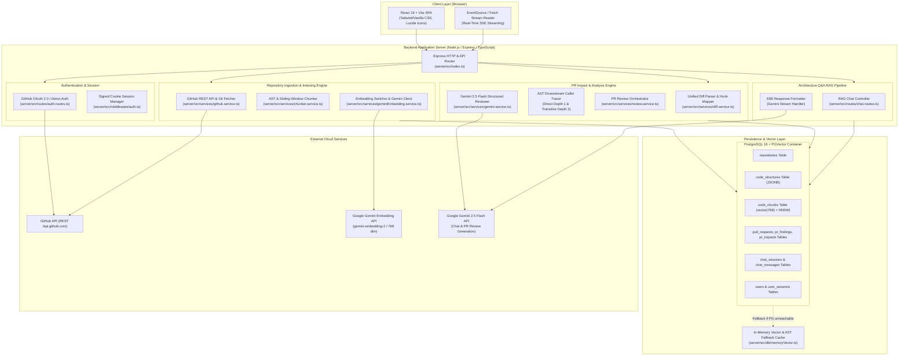

# Module 01: CodeSense System Architecture & Topology

## 1. What CodeSense Does & The Problem It Solves

### The Developer Problem
In modern software engineering, code review and repository onboarding are high-friction bottlenecks:
1. **Blind Pull Request Reviews**: When a developer alters a function signature, changes a database query, or modifies a service method, reviewing the diff alone in GitHub (`Files Changed`) only shows what changed in isolation. It does not show *who calls that function across 500 files*, what downstream microservices or controllers break, or whether existing tests cover the modification.
2. **Hallucinating AI Reviewers**: Generic LLM code assistants review PR diffs without repo-wide structural awareness. They invent hypothetical callers, hallucinate non-existent files, and produce generic advice ("add error handling") rather than verified architectural impact.
3. **Context-Blind Code Comprehension**: New engineers joining a massive codebase spend weeks reading files manually because keyword search cannot explain architecture, data flows, or dependency hierarchies.

### The CodeSense Solution
**CodeSense** (historically named *devPilot* in early prototypes) is an **AI-powered Codebase Comprehension and Evidence-Backed Pull Request Review Copilot**. 

Unlike standard RAG tools that simply chunk text arbitrarily, CodeSense operates on a **hybrid dual-engine architecture**:
- **Deterministic Static AST Engine**: Parses TypeScript, JavaScript, Java, and Python source files into explicit Abstract Syntax Trees (ASTs), extracting declared classes, methods, imports, and cross-file call graphs. It mathematically verifies downstream callers (Direct Depth 1 and Transitive Depth 2) with deterministic certainty.
- **Semantic Vector Engine (Google Gemini & PGVector)**: Uses Google Gemini embeddings (`gemini-embedding-2`, 768 dimensions) stored in PostgreSQL with the `pgvector` extension to retrieve conceptually relevant code chunks for domain context and architecture questions.
- **Evidence-Grounded Review Synthesizer (Gemini 2.5 Flash)**: Synthesizes both deterministic AST caller hierarchies and semantic vector context into actionable PR reviews, test recipes, and impact graphs—strictly constrained so that semantic similarity is never confused with verified execution paths.

---

## 2. High-Level System Architecture

---

## 3. Technology Stack & Component Responsibilities

| Tier | Component | Real Project Implementation | Primary Responsibility |
| :--- | :--- | :--- | :--- |
| **Frontend** | React 19 + Vite | `frontend/src/App.jsx`, `frontend/src/components/*` | Single-page UI rendering repository dashboards, interactive AST explorer tree, real-time SSE streaming architecture chat, and PR impact reports with severity categorization. |
| **Backend Entry** | Node.js / Express / TypeScript | `server/src/index.ts` | Handles CORS negotiation, JSON parsing, cookie decoding, rate limiting, and routing across `/api/auth`, `/api/repos`, `/api/pull-requests`, `/api/chat`, and `/api/health`. |
| **Configuration** | Environment Manager | `server/src/config/env.ts` | Centralized environment loader validating ports, Gemini/Voyage credentials, vector dimensions, rate limits, and allowed frontend origins. |
| **Database & Vector** | PostgreSQL 16 + PGVector | `server/src/db/pgvector.ts` (Docker Compose) | Stores repositories, AST structures (`JSONB`), 768-dimensional code chunk embeddings (`vector(768)`), HNSW cosine indexes, chat transcripts, and PR review findings. |
| **In-Memory Cache** | In-Memory Fallback Engine | `server/src/db/memoryVector.ts` | Provides pure in-memory cosine similarity and repository storage when PostgreSQL or PGVector is not yet provisioned, allowing instant offline/local development. |
| **AST Parser** | TypeScript Compiler API + Scanners | `server/src/services/chunker.service.ts` | Generates concrete syntax trees for TS/JS using `ts.createSourceFile`, and syntactic block scanners for Java and Python. Extracts functions, classes, line ranges, and called symbols. |
| **Embeddings** | Google Generative AI SDK | `server/src/services/geminiEmbedding.service.ts` | Connects to Google's official `@google/generative-ai` SDK using `gemini-embedding-2`, `TaskType.RETRIEVAL_DOCUMENT` for code chunks, and `TaskType.RETRIEVAL_QUERY` for questions. |
| **PR Analysis** | Diff Parser & Caller Engine | `server/src/services/diff.service.ts` | Parses raw git unified diffs, correlates line mutations with AST symbols, traces confirmed vs inferred callers up to depth 2, and spots behavior signature breaks. |
| **Orchestration** | Review Coordinator | `server/src/services/review.service.ts` | Pulls repository ASTs, checks for unindexed repositories, coordinates static AST analysis with PGVector semantic search, and triggers Gemini structured review. |
| **LLM Synthesis** | Gemini 2.5 Flash | `server/src/services/gemini.service.ts` | Generates structured PR reviews adhering strictly to grounded JSON schemas, and powers streaming architecture chat via Server-Sent Events (SSE). |

---

## 4. Key Architectural Insights & Reality vs. Assumptions

During architectural inspection of the repository, several critical realities were uncovered that distinguish the actual working system from outdated documentation:

1. **Active Node.js Server vs. Legacy Java Backend**:
   - The root contains a `pom.xml` and `src/main/java/devPilot` folder from an earlier Spring Boot 3 prototype.
   - **The active, production runtime is completely located in `server/`** (Node.js 20+, Express, TypeScript, ESM modules). The npm scripts in root run `npm run dev --prefix server` and `npm run dev --prefix frontend`.
2. **AST Parsing Library**:
   - Earlier design notes referenced Tree-sitter. 
   - **The actual codebase uses the official TypeScript Compiler API (`typescript`)** for TypeScript/JavaScript (`server/src/services/chunker.service.ts`), plus specialized lexical scanners for Java and Python. This avoids native C++ binary bindings and improves cross-platform portability across Windows, macOS, and Linux.
3. **Embedding Model & Vector Dimension**:
   - The active embedding provider defaults to **Google Gemini** (`gemini-embedding-2` producing 768-dimensional vectors) in `server/src/config/env.ts` and `server/src/services/geminiEmbedding.service.ts`.
   - An optional provider, Voyage AI (`voyage-code-3`, 1536 dimensions), is maintained as an alternate provider via `server/src/services/voyage.service.ts`.
4. **Deterministic Callers vs. Semantic Similarity**:
   - CodeSense strictly enforces that **semantic vector similarity is NEVER treated as a caller dependency**. Downstream caller relationships (`CONFIRMED`, `INFERRED`, `TRANSITIVE`) are calculated strictly by static AST examination in `diff.service.ts`. Vector search is used solely as supplementary contextual background.

---

## 5. Hackathon Judge Technical Questions & Defense

### Q1: "Why did you build both an AST parser and vector embeddings? Isn't vector RAG enough for code review?"
> **Answer**: "Vector similarity only measures *conceptual closeness*, not *execution truth*. If a developer changes the signature of `authService.validateToken(user, token)` to `validateToken(tokenConfig)`, vector search might find files that talk about authentication, but it cannot tell you which 14 controllers break at runtime. Our TypeScript Compiler AST engine maps line changes to exact symbol declarations and traces caller hierarchies deterministically. Vectors provide domain background; ASTs provide mathematical impact truth."

### Q2: "What happens if a user submits a PR for a repository that hasn't been indexed yet?"
> **Answer**: "The `ReviewService` (`server/src/services/review.service.ts`) detects that repository AST structures are missing. It dynamically fetches modified files directly from the GitHub contents API at the PR head commit and extracts ad-hoc AST structures on the fly. Furthermore, it explicitly sets `structuralAnalysisAvailable: false`, inserts a warning in the report limitations, and labels the callers so engineers know full static propagation could not be computed."

### Q3: "How does CodeSense handle database outages or environments without Docker?"
> **Answer**: "We built a dual-tier storage strategy in `server/src/db/pgvector.ts` and `server/src/db/memoryVector.ts`. If PostgreSQL or PGVector is unreachable upon startup, the system automatically falls back to an in-memory vector cache with pure cosine similarity calculation. The application runs seamlessly in local demo mode without crashing."

---

## 6. Five Short Questions to Test Your Understanding

1. Which directory contains the active runtime server, and which directory contains the legacy prototype?
2. What are the two distinct engines that make up CodeSense's hybrid analysis pipeline?
3. What is the active default embedding model and its output vector dimension?
4. Why does CodeSense avoid using vector similarity to claim a function calls another function?
5. How does the application behave if PostgreSQL is shut down during execution?
