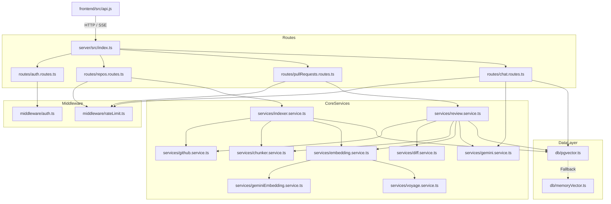

# Module 02: Repository Layout, Entry Points & Module Map

## 1. Complete Project Directory Structure

```text
c:\Users\KARAN BISHT\OneDrive\Desktop\backend\
│
├── .repos_cache/                         # Local git clones created during indexing (git clone/fetch)
│
├── docker-compose.yml                    # Docker Compose: PostgreSQL 16 + pgvector (ankane/pgvector)
├── package.json                          # Workspace root orchestrator (npm run dev runs server & frontend)
├── pom.xml                               # [LEGACY] Maven project file from Java/Spring Boot prototype
├── PROJECT_CONTEXT.md                    # Project context & architecture specification document
├── README.md                             # High-level overview & setup instructions
├── README_AUDIT_FIXES.md                 # Detailed security, architecture & bugfix audit log
│
├── frontend/                             # Active React 19 Frontend Application (Vite SPA)
│   ├── index.html                        # SPA HTML root entry
│   ├── package.json                      # React 19, Vite, Lucide-react, Tailwind dependencies
│   ├── vite.config.js                    # Vite bundler configuration (dev server on port 5173)
│   └── src/
│       ├── main.jsx                      # React DOM mount point (binds to #root)
│       ├── App.jsx                       # Master UI controller, navigation state, and tab manager
│       ├── api.js                        # Unified HTTP client & SSE streaming reader
│       ├── App.css                       # Application layout styling
│       ├── index.css                     # Global design tokens, crimson cyberpunk palette & animations
│       └── components/                   # Interactive UI modules
│           ├── Navbar.jsx                # Header navigation bar & tab switcher
│           ├── SidebarLayout.jsx         # Sidebar navigation layout wrapper
│           ├── LandingPage.jsx           # Landing / hero page with feature highlights
│           ├── DashboardHome.jsx         # Active repository overview, stats & quick actions
│           ├── RepoDashboard.jsx         # Repository import, indexing progress bar & file count
│           ├── RepoComprehension.jsx     # RAG architecture chat & Q&A interface
│           ├── CodeTreeVisualizer.jsx    # Interactive AST hierarchy visualizer & file inspector
│           ├── PrAnalysisView.jsx        # Pull request diff viewer, impact graph & review findings
│           └── StructuredAiResponse.jsx  # Markdown & structured code block formatter
│
├── server/                               # Active Node.js / TypeScript Backend Application
│   ├── package.json                      # Dependencies: express, pg, @google/generative-ai, typescript
│   ├── tsconfig.json                     # TypeScript compiler settings (NodeNext ESM modules)
│   ├── .env.example                      # Documented environment variable template
│   └── src/
│       ├── index.ts                      # Backend Entry Point: Express setup, CORS, route mounting
│       ├── config/
│       │   └── env.ts                    # Centralized environment loader, Zod defaults & model configs
│       ├── db/
│       │   ├── pgvector.ts               # Primary PostgreSQL + PGVector client, tables & HNSW query
│       │   └── memoryVector.ts           # In-memory vector cache & fallback for offline/demo mode
│       ├── middleware/
│       │   ├── auth.ts                   # Signed cookie session validator (`codesense_session`)
│       │   └── rateLimit.ts              # In-memory rate limiting middleware for AI, Auth, and Indexing
│       ├── routes/
│       │   ├── auth.routes.ts            # GitHub OAuth 2.0 flow, session check, demo login & logout
│       │   ├── repos.routes.ts           # Repository import, indexing status, AST tree retrieval
│       │   ├── pullRequests.routes.ts    # PR analysis trigger, findings list & impact report endpoint
│       │   └── chat.routes.ts            # RAG question answering with Server-Sent Events (SSE) stream
│       ├── services/
│       │   ├── chunker.service.ts        # TS Compiler AST parsing, Java/Python scanners, 50-line window
│       │   ├── diff.service.ts           # Unified diff parsing, line-to-symbol mapping, caller tracing
│       │   ├── embedding.service.ts      # Active provider switcher (Gemini vs. Voyage)
│       │   ├── geminiEmbedding.service.ts# Google Generative AI batchEmbedContents (gemini-embedding-2)
│       │   ├── gemini.service.ts         # Gemini 2.5 Flash structured PR review & streaming chat
│       │   ├── github.service.ts         # GitHub REST API client, URL parser, Git diff & commit blobs
│       │   ├── indexer.service.ts        # Ingestion pipeline coordinator (discover -> AST -> embed -> save)
│       │   ├── review.service.ts         # PR analysis coordinator (diff -> AST -> callers -> Gemini)
│       │   └── voyage.service.ts         # Voyage AI embedding service (voyage-code-3 fallback)
│       ├── types/
│       │   └── index.ts                  # Shared TypeScript interfaces (AST, Diffs, Findings, Models)
│       └── test/
│           ├── testDb.ts                 # Database connectivity test harness
│           └── testEnv.ts                # Environment verification test script
│
└── src/                                  # [LEGACY / PROTOTYPE] Spring Boot 3 Java Codebase
    ├── main/java/devPilot/               # Historical Java backend (Controllers, Repositories, Services)
    └── test/java/devPilot/               # Historical Java JUnit test suites
```

---

## 2. Active vs. Legacy Code Distinction

A critical discovery when analyzing this repository is that **the project underwent a major architectural migration**:

1. **Legacy Prototype (`src/main/java/devPilot`, `pom.xml`)**:
   - Written in Java 21 with Spring Boot 3, Spring Data JPA, and LangChain4j.
   - Designed to run via Maven (`./mvnw spring-boot:run`).
   - It is **inactive** during normal operation. Running `npm run dev` at the root does NOT invoke Java or Maven.
2. **Production System (`server/` and `frontend/`)**:
   - Modernized into a Node.js 20+ / TypeScript ESM backend and React 19 frontend.
   - Built for ultra-fast startup, native TypeScript AST integration via the official TypeScript compiler API (`typescript`), and direct integration with Google's `@google/generative-ai` SDK.
   - All active development, bug fixes, database migrations, and UI interactions occur entirely within `server/` and `frontend/`.

---

## 3. Active Application Entry Points

### Backend Entry Point: `server/src/index.ts`
- **Execution Command**: `npm run dev --prefix server` (runs `tsx watch src/index.ts`).
- **Initialization Sequence**:
  1. Loads environment variables from `.env` and `server/.env` via `server/src/config/env.ts`.
  2. Sets up Express with CORS (permissive in development, strict whitelist in production).
  3. Configures body parsers with a 10MB payload ceiling for large git diffs.
  4. Mounts `cookieParser(ENV.SESSION_SECRET)` for signed authentication cookies.
  5. Registers request logging middleware (filtering out noisy polling `/status` endpoints).
  6. Mounts the 5 core route groups:
     - `/api/auth` -> `server/src/routes/auth.routes.ts`
     - `/api/repos` -> `server/src/routes/repos.routes.ts`
     - `/api/pull-requests` -> `server/src/routes/pullRequests.routes.ts`
     - `/api/chat` -> `server/src/routes/chat.routes.ts`
     - `/api/health` -> Inline health monitor in `server/src/index.ts`
  7. Invokes `db.initialize()` in `server/src/db/pgvector.ts`:
     - Verifies PostgreSQL connectivity.
     - Runs `CREATE EXTENSION IF NOT EXISTS vector;`.
     - Validates and creates all relational tables and HNSW indexes.
     - **Interrupted Job Recovery**: Resets any orphaned indexing jobs marked as `INDEXING` to `FAILED` with a safe retry explanation.
  8. Binds to `http://localhost:8080`.

### Frontend Entry Point: `frontend/src/main.jsx` & `frontend/src/App.jsx`
- **Execution Command**: `npm run dev --prefix frontend` (runs `vite`).
- **Initialization Sequence**:
  1. `main.jsx` bootstraps React 19 and renders `<App />` into the DOM `#root` container.
  2. `App.jsx` executes an initial `checkAuthStatus()` call to `/api/auth/me`.
  3. Fetches the list of ingested repositories via `/api/repos`.
  4. Maintains active tab state:
     - `DASHBOARD`: Ingested repos, stats, recent activity (`DashboardHome.jsx`).
     - `REPOS`: Repository import, clone progress, file counters (`RepoDashboard.jsx`).
     - `CODE_TREE`: Interactive AST hierarchy viewer (`CodeTreeVisualizer.jsx`).
     - `COMPREHENSION`: Streaming architecture chat (`RepoComprehension.jsx`).
     - `PR_ANALYSIS`: Full PR impact, diff inspection & review findings (`PrAnalysisView.jsx`).

---

## 4. Key Configuration Files

| Configuration File | Path | Key Settings & Directives |
| :--- | :--- | :--- |
| **Workspace Orchestrator** | `package.json` | `scripts: { "dev": "concurrently \"npm run dev --prefix server\" \"npm run dev --prefix frontend\"" }` |
| **Server Environment** | `server/src/config/env.ts` | Sets `PORT` (8080), `DATABASE_URL`, `EMBEDDING_PROVIDER` ('gemini'), `GEMINI_EMBEDDING_MODEL` ('gemini-embedding-2'), `GEMINI_EMBEDDING_DIMENSION` (768), `RATE_LIMIT_AI_MAX` (20), `ALLOWED_ORIGINS`. |
| **Docker Compose** | `docker-compose.yml` | Image `ankane/pgvector:v0.5.1`, container `codesense-pgvector`, port `5432:5432`, database `codesense_db`, volume `pgvector-data`. |
| **Server Build & ESM** | `server/tsconfig.json` | `target: "ES2022"`, `module: "NodeNext"`, `moduleResolution: "NodeNext"`, `strict: true`. |
| **Frontend Bundler** | `frontend/vite.config.js` | Uses `@vitejs/plugin-react`, local dev server on port `5173`. |

---

## 5. Module Call Hierarchy & Dependency Graph



---

## 6. Five Short Questions to Test Your Understanding

1. What file in the repository serves as the central router mounting all backend API endpoints?
2. Why is there a `pom.xml` file in the root if the active server runs in TypeScript?
3. What is the role of `server/src/config/env.ts` during application startup?
4. How does the frontend communicate with the backend during RAG architecture chat?
5. What mechanism automatically recovers indexing jobs if the server is abruptly terminated while processing a repository?
