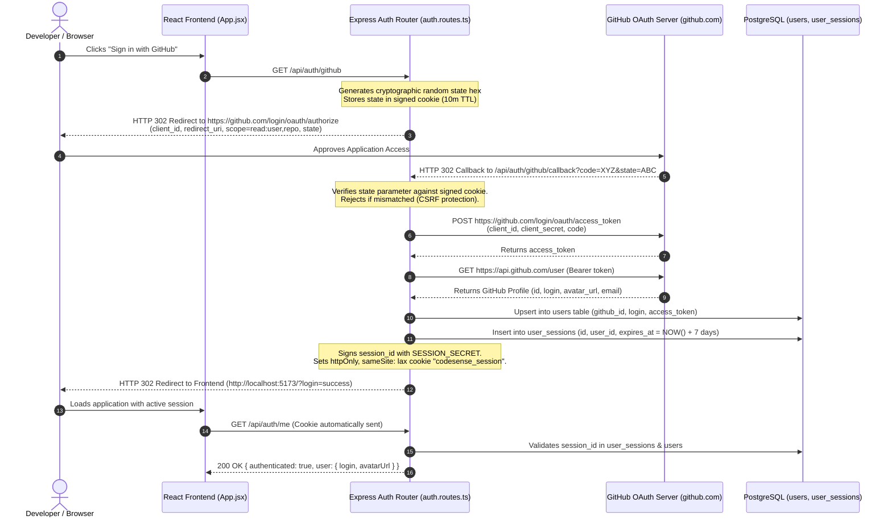

# Module 03: Authentication, GitHub OAuth, Sessions & Authorization

## 1. What Authentication Does in CodeSense

Authentication in CodeSense serves three distinct functions:
1. **Developer Identity**: Identifies who is importing repositories and requesting PR reviews.
2. **GitHub API Authorization**: Exchanges OAuth tokens to increase GitHub API rate limits from 60 unauthenticated requests/hour to 5,000 authenticated requests/hour, and grants access to read private user repositories.
3. **Local Developer Fast-Path**: Provides an instant demo login mode so developers can test all features without having to register a GitHub OAuth application during local hackathon demos.

---

## 2. GitHub OAuth 2.0 Lifecycle & Trace



---

## 3. Detailed Step-by-Step Code Walkthrough

### Step A: Authorization Initiation (`server/src/routes/auth.routes.ts`)
When the user clicks the GitHub Login button, the browser is directed to `/api/auth/github`.

```typescript
// server/src/routes/auth.routes.ts: lines 45-68
router.get('/github', (req, res) => {
  if (!ENV.isGitHubOAuthConfigured) {
    return res.status(503).json({
      error: 'GitHub OAuth is not configured on this server. Set GITHUB_CLIENT_ID and GITHUB_CLIENT_SECRET.',
      fallbackDemoLoginUrl: '/api/auth/demo-login'
    });
  }

  // Generate cryptographic state for CSRF protection
  const state = crypto.randomBytes(24).toString('hex');
  res.cookie('oauth_state', state, {
    httpOnly: true,
    secure: ENV.NODE_ENV === 'production',
    sameSite: 'lax',
    maxAge: 10 * 60 * 1000 // 10 minutes
  });

  const params = new URLSearchParams({
    client_id: ENV.GITHUB_CLIENT_ID,
    redirect_uri: ENV.GITHUB_CALLBACK_URL,
    scope: 'read:user,repo',
    state
  });

  res.redirect(`https://github.com/login/oauth/authorize?${params.toString()}`);
});
```

### Step B: Callback Verification & Token Exchange (`server/src/routes/auth.routes.ts`)
GitHub redirects the user back to `/api/auth/github/callback` with an authorization `code` and the `state` value.

```typescript
// server/src/routes/auth.routes.ts: lines 71-125
router.get('/github/callback', async (req, res) => {
  const { code, state } = req.query;
  const storedState = req.cookies.oauth_state;

  // 1. Verify CSRF state token
  if (!state || !storedState || state !== storedState) {
    return res.status(400).send('OAuth state verification failed. Possible CSRF attack.');
  }
  res.clearCookie('oauth_state');

  // 2. Exchange authorization code for GitHub access token
  const tokenResponse = await fetch('https://github.com/login/oauth/access_token', {
    method: 'POST',
    headers: {
      'Content-Type': 'application/json',
      Accept: 'application/json'
    },
    body: JSON.stringify({
      client_id: ENV.GITHUB_CLIENT_ID,
      client_secret: ENV.GITHUB_CLIENT_SECRET,
      code
    })
  });
  const tokenData = await tokenResponse.json();
  const accessToken = tokenData.access_token;

  // 3. Fetch authenticated user details from GitHub
  const userResponse = await fetch('https://api.github.com/user', {
    headers: {
      Authorization: `Bearer ${accessToken}`,
      'User-Agent': 'CodeSense-Copilot'
    }
  });
  const githubUser = await userResponse.json();

  // 4. Upsert user record and create persistent session
  const user = await db.upsertUser({
    id: `user-${githubUser.id}`,
    githubId: String(githubUser.id),
    login: githubUser.login,
    name: githubUser.name || githubUser.login,
    email: githubUser.email,
    avatarUrl: githubUser.avatar_url,
    accessToken
  });

  const session = await db.createUserSession(user.id, 7); // 7-day session

  // 5. Set signed HTTP-only cookie
  res.cookie(ENV.SESSION_COOKIE_NAME, session.id, {
    httpOnly: true,
    signed: true,
    secure: ENV.NODE_ENV === 'production',
    sameSite: 'lax',
    maxAge: 7 * 24 * 60 * 60 * 1000
  });

  res.redirect(`${ENV.FRONTEND_URL}/?login=success`);
});
```

---

## 4. Session Validation & Middleware (`server/src/middleware/auth.ts`)

To protect routes or resolve the current user context, Express uses middleware functions:

1. **`requireAuth`**: Enforces that a valid session cookie exists and has not expired. If invalid or missing, it halts execution with `HTTP 401 Unauthorized`.
2. **`optionalAuth`**: Extracts session credentials if provided, attaching `req.user` and `req.session` to the request object. If absent, the request proceeds anonymously.

```typescript
// server/src/middleware/auth.ts
export async function optionalAuth(req: Request, res: Response, next: NextFunction) {
  const sessionId = req.signedCookies[ENV.SESSION_COOKIE_NAME];
  if (!sessionId) {
    return next();
  }

  const session = await db.getUserSession(sessionId);
  if (!session || new Date(session.expiresAt) < new Date()) {
    return next();
  }

  const user = await db.getUserById(session.userId);
  if (user) {
    (req as any).user = user;
    (req as any).session = session;
  }
  next();
}
```

---

## 5. Local Demo Login Mechanism

To ensure reviewers and hackathon judges can immediately test the platform without configuring GitHub OAuth credentials, CodeSense provides a dedicated demo login endpoint:
- **Endpoint**: `POST /api/auth/demo-login` (or `GET /api/auth/demo-login`)
- **Behavior**:
  1. Creates or retrieves a local user: `demo-user-12345` (`login: "codesense-reviewer"`).
  2. Issues a genuine 7-day session in `user_sessions`.
  3. Writes the signed `codesense_session` cookie to the browser.
  4. Returns `200 OK` with full session metadata.

---

## 6. Logout Flow (`/api/auth/logout`)

When the user clicks logout in `frontend/src/components/Navbar.jsx`:
1. Client sends a `POST /api/auth/logout` request.
2. Server extracts `req.signedCookies[ENV.SESSION_COOKIE_NAME]`.
3. Invokes `db.deleteUserSession(sessionId)` to invalidate the record in PostgreSQL.
4. Clears the cookie in the browser via `res.clearCookie(ENV.SESSION_COOKIE_NAME)`.
5. Frontend resets its local React user state to `null`.

---

## 7. Security Assessment: Safeguards vs. Remaining Gaps

| Dimension | Implemented Status | Actual Implementation Detail |
| :--- | :--- | :--- |
| **CSRF Protection on OAuth** | **VERIFIED** | Cryptographic random hex generated in `crypto.randomBytes(24)`, stored in short-lived (10m) HTTP-only cookie, and validated strictly against the GitHub callback `state`. |
| **Cookie Tampering** | **VERIFIED** | Signed using `cookieParser(ENV.SESSION_SECRET)`. Tampered session IDs fail cookie signature verification automatically. |
| **XSS Protection** | **VERIFIED** | `httpOnly: true` prevents client-side JavaScript from accessing session tokens. `sameSite: 'lax'` prevents cross-site request forgery. |
| **Session Invalidation** | **VERIFIED** | Server-side deletion in PostgreSQL prevents replay attacks after logout. |
| **Token Encryption at Rest** | **PARTIALLY IMPLEMENTED** | GitHub `access_token` is stored as plain text in the `users` table column. In production environments, database column encryption (e.g., via AES-256-GCM) should be applied. |
| **Multi-Tenant User Isolation** | **PARTIALLY IMPLEMENTED** | Repositories and PRs are indexed globally; access control does not yet restrict private repository data solely to the GitHub user who imported it. |

---

## 8. Five Short Questions to Test Your Understanding

1. What mechanism prevents Cross-Site Request Forgery (CSRF) during the GitHub OAuth handshake?
2. Why is the session cookie configured with `httpOnly: true`?
3. What is the difference between `requireAuth` and `optionalAuth` middleware?
4. How does the demo login endpoint allow testing without GitHub OAuth client secrets?
5. Where are active session expiration dates tracked and validated?
