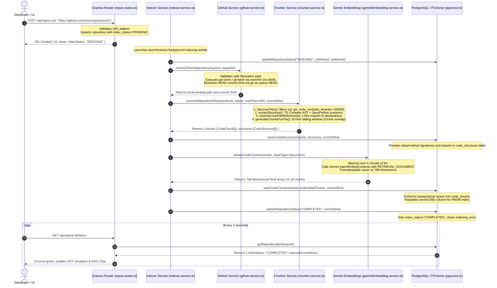

# Module 04: Repository Ingestion & Indexing Pipeline

## 1. End-to-End Ingestion Trace

When a developer submits a GitHub repository URL (e.g., `https://github.com/expressjs/express`) in `frontend/src/components/RepoDashboard.jsx`, the complete end-to-end ingestion pipeline executes across several stages:



---

## 2. URL Validation & Security Protections

Submitting arbitrary URLs from the web to a backend that executes Git operations requires strict validation against command injection, SSRF, and directory traversal:

1. **URL Sanitization (`server/src/services/github.service.ts`)**:
   - `parseGitHubUrl(url)` checks the URL against strict regex patterns matching GitHub HTTP/HTTPS, SSH, and shorthand notations (`owner/repo`).
   - Non-GitHub hostnames, non-alphanumeric characters, and embedded shell control operators (`;`, `&&`, `|`, `` ` ``, `$`) are rejected immediately.
2. **Path Traversal Defense**:
   - Repository cache directories are created under `.repos_cache/<owner>_<repo>` using `path.resolve`.
   - Before executing any operation, `validatePathSafety(targetDir)` verifies that the resolved path is strictly located within the designated `REPOS_STORAGE_DIR`. If a malicious input contains `../../`, it is blocked before reaching the disk.
3. **No Shell Spawning (`child_process.execFile`)**:
   - Git operations never call `child_process.exec` (which spawns an OS shell like `/bin/sh` or `cmd.exe`).
   - Instead, the service uses `child_process.execFile('git', args)` where each command-line parameter is passed as a discrete string array element. This eliminates shell argument injection vulnerabilities.

---

## 3. Git Fetching & Commit SHA Resolution

CodeSense supports two complementary methods for acquiring repository source code:

1. **Local Clone / Fetch Mode (`githubService.cloneOrFetchRepository`)**:
   - If the repository has not been fetched before:
     `git clone --depth 1 https://github.com/owner/repo.git .repos_cache/owner_repo`
   - If the repository was previously cloned:
     `git fetch --depth 1 origin <defaultBranch>` followed by `git checkout FETCH_HEAD`
   - **Commit SHA Resolution**:
     Executes `git rev-parse HEAD` inside the repository directory to lock the exact 40-character commit SHA.
2. **GitHub REST API Fallback Mode (`githubService.getRepoTree`)**:
   - When running in restricted cloud environments where local `git` binaries or filesystem access are disabled, the system can fetch files directly via the GitHub Git Trees API (`GET /repos/{owner}/{repo}/git/trees/{sha}?recursive=1`).

---

## 4. File Discovery & Filtering (`chunker.service.ts`)

Repository crawling is handled by `CodeChunkerService.discoverFiles(dir)`:
- **Ignored Directories**:
  `.git`, `node_modules`, `dist`, `build`, `target`, `.mvn`, `.vscode`, `.idea`, `vendor`, `coverage`, `.next`.
- **Supported Language Extensions**:
  `.ts`, `.tsx`, `.js`, `.jsx`, `.java`, `.py`, `.go`, `.rs`, `.cpp`, `.c`, `.h`, `.cs`, `.rb`, `.php`, `.sql`, `.md`.
- **Safety Ceilings**:
  - Maximum indexed files per repository: `maxFiles = 600` (prevents memory exhaustion on monolithic repos).
  - Maximum file size: `500,000 bytes` (~500KB). Any file exceeding this limit is treated as minified or binary code and skipped.
  - Hidden files (starting with `.`, except `.env`) are ignored.

---

## 5. Structural Skeleton vs. Vector Chunk Storage

A key architectural design in CodeSense is that **structural data is stored completely separately from vector chunks**:

| Data Type | Database Table | Purpose | Format |
| :--- | :--- | :--- | :--- |
| **Structural Skeleton** | `code_structures` | Fast deterministic lookups for caller hierarchies, classes, methods, and imports. | JSONB (`classes_json`, `methods_json`, `imports_json`). No embeddings. |
| **Vector Chunks** | `code_chunks` | Semantic text retrieval for RAG chat and contextual domain matching. | Raw text, line numbers, and a `vector(768)` embedding column. |

This separation enables CodeSense to query AST relationships with zero vector search latency, while keeping vector queries fast and focused on text semantics.

---

## 6. Indexing State Management & Crash Recovery

Repository indexing transitions through four distinct lifecycle states:
- `PENDING`: Initial registration; waiting for worker queue.
- `INDEXING`: Active cloning, AST parsing, and Gemini embedding generation.
- `COMPLETED`: Successfully indexed; all chunks, embeddings, and AST structures are committed to PostgreSQL.
- `FAILED`: Indexing encountered an error (e.g., clone timeout, invalid API key, oversized files).

### Startup Crash Recovery (`server/src/db/pgvector.ts`)
If the server process crashes or is restarted while indexing a large repository:
- The repository remains stuck in `INDEXING` state.
- During `db.initialize()` on server startup, the system executes:
  ```sql
  UPDATE repositories
  SET index_status = 'FAILED',
      indexing_error = 'Indexing process was interrupted by server restart or process termination. Safe to retry.',
      updated_at = NOW()
  WHERE index_status = 'INDEXING';
  ```
- This guarantees that repositories are never trapped in an endless loading state.

---

## 7. Five Short Questions to Test Your Understanding

1. Why does `github.service.ts` use `execFile` instead of `exec` to run Git commands?
2. What happens to files larger than 500KB during repository ingestion?
3. What is the maximum number of files indexed per repository by default?
4. Why are structural ASTs stored in `code_structures` separately from `code_chunks`?
5. How does the database recover if the server crashes in the middle of indexing a repository?
