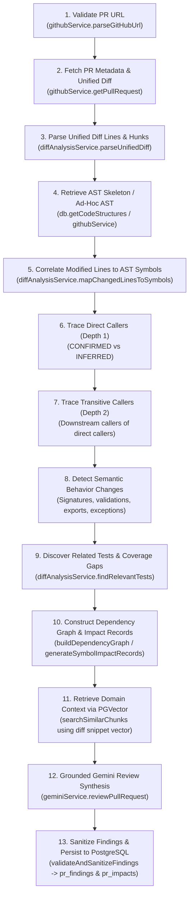

# Module 08: Pull Request Review & Change-Impact Analysis Engine

> **Architectural Note**: This is the core differentiator of CodeSense. While other tools merely show unified diffs or summarize text with an LLM, CodeSense combines **deterministic AST structural call graphs** with **semantic vector search** and **grounded Gemini synthesis** to compute real change-impact reports.

---

## 1. The 13-Step PR Analysis Pipeline



---

## 2. Step-by-Step Implementation Deep-Dive

### Step 1: Validate PR URL (`github.service.ts`)
- `parseGitHubUrl(url)` checks the URL against regex:
  `^https?:\/\/github\.com\/([a-zA-Z0-9_.-]+)\/([a-zA-Z0-9_.-]+)\/pull\/(\d+)`
- Rejects invalid URLs and extracts `owner`, `repo`, and `prNumber`.

### Step 2: Fetch PR Metadata & Unified Diff (`github.service.ts`)
- Queries GitHub REST API:
  - `GET /repos/{owner}/{repo}/pulls/{prNumber}`: Extracts `title`, `base.sha`, `head.sha`, and `state`.
  - `GET /repos/{owner}/{repo}/pulls/{prNumber}` with header `Accept: application/vnd.github.v3.diff`: Fetches the complete raw unified diff.

### Step 3: Parse Unified Diff Lines & Hunks (`diff.service.ts`)
- `parseUnifiedDiff(diffText)` splits the diff by `diff --git`:
  - Extracts old path (`--- a/`) and new path (`+++ b/`).
  - Detects status: `MODIFIED`, `ADDED`, or `DELETED`.
  - Parses hunk headers: `@@ -start,len +start,len @@`.
  - Indexes exact added, deleted, and modified line numbers.

### Step 4 & 5: Correlate Changed Lines to AST Symbols (`diff.service.ts`)
- `mapChangedLinesToSymbols(changedFiles, structures)`:
  - Iterates through modified line numbers in each file.
  - Matches them against the line ranges `[startLine, endLine]` of declared methods and classes from the repository's AST skeleton.
  - Generates `affectedSymbolsByFile`: an exact mapping of which classes and methods were modified in this PR.

### Step 6 & 7: Trace Downstream Callers (`diff.service.ts`)
- `traceStructuralCallers(affectedSymbolsByFile, structures, maxDepth = 2)`:
  - **Direct Callers (Depth 1)**: Inspects all other files across the repository:
    - **CONFIRMED**: File contains an `import` pointing to the modified module **AND** invokes the changed method name.
    - **INFERRED**: File invokes a same-named method but lacks an explicit resolved import, or imports the module without a verified invocation.
  - **Transitive Callers (Depth 2)**: For each CONFIRMED direct caller, scans the repository for secondary functions that invoke the direct caller.
  - Records line ranges, evidence strings, and component categories (`CONTROLLER`, `SERVICE`, `REPOSITORY`, `UTILITY`).

### Step 8: Detect Semantic Behavior Changes (`diff.service.ts`)
- `detectSemanticBehaviorChanges(changedFiles, structures)`:
  - Scans diff hunks for structural signature breaks:
    - Function parameter additions/removals (`SIGNATURE_CHANGE`).
    - Added or removed throw statements (`EXCEPTION_CHANGE`).
    - Added or modified `if (...) throw / return` (`VALIDATION_CHANGE`).
    - Export removals (`BREAKING_EXPORT`).

### Step 9: Discover Tests & Missing Coverage (`diff.service.ts`)
- `findRelevantTests(affectedSymbolsByFile, structures)`:
  - Searches for test files matching `*.test.ts`, `*.spec.js`, `*Test.java`, or `test_*.py`.
  - Checks if test files import or invoke modified symbols.
  - If a modified method has **zero** referencing test files, flags a `BehaviorRisk` with `missingTest: true` and generates a customized unit test recipe.

### Step 10: Build Dependency Graph & Impact Records (`diff.service.ts`)
- Constructs a directed graph of `DependencyNode` (files, classes, methods) and `DependencyEdge` (`CALLS`, `IMPORTS`, `TESTS`).
- Generates `SymbolImpactRecord` objects detailing downstream blast radius, risk score (0-100), and caller counts.

### Step 11: Vector Search for Domain Background (`review.service.ts`)
- Embeds the diff snippet (up to 1,500 chars) using `geminiEmbeddingService.embedQuery`.
- Queries PGVector for the top 8 conceptually related code chunks to provide domain knowledge to the LLM.
- **Strict Distinction**: Vector chunks are passed as background reading; they are NEVER labeled as callers.

### Step 12: Grounded Gemini Review Synthesis (`gemini.service.ts`)
- Assembles a structured prompt for Gemini 2.5 Flash containing:
  - PR Title & Unified Diff.
  - Confirmed Callers (with line ranges).
  - Semantic Behavior Changes.
  - Existing Tests and Missing Coverage.
  - PGVector Domain Chunks.
- Enforces strict JSON response schema:
  - `findings[]`: Array of `PrFinding` (severity, category, title, lineRange, suggestedFix, impactExplanation, testRecipe).
  - `overallResult`: `APPROVE`, `REQUEST_CHANGES`, or `COMMENT`.
  - `summaryText` & `limitations`.

### Step 13: Sanitize Findings & Persist to Database (`review.service.ts`)
- `validateAndSanitizeFindings(findings, changedFiles, structures)`:
  - Rejects any hallucinated findings referencing non-existent files or out-of-bounds line numbers.
  - Saves validated findings to `pr_findings` table.
  - Saves impact records, dependency graph, and caller hierarchy to `pr_impacts` table.
  - Updates `pull_requests` record to `status: 'COMPLETED'`.

---

## 3. Concrete Impact Scenario: Changing a Service Method Signature

Consider modifying a service method signature in an e-commerce API:

```diff
// services/paymentService.ts
- export async function processPayment(orderId: string, amount: number): Promise<boolean> {
+ export async function processPayment(paymentRequest: PaymentRequestDto): Promise<PaymentResult> {
```

### How CodeSense Traces Impact:
1. **Diff Parser**: Detects modifications to lines 1–2 in `services/paymentService.ts`.
2. **AST Mapper**: Correlates lines 1–2 with method `processPayment` in class `PaymentService`.
3. **Behavior Detector**: Flags `SIGNATURE_CHANGE` (parameters changed from `(orderId, amount)` to `(paymentRequest)`).
4. **Direct Caller Tracer (Depth 1)**:
   - Scans `controllers/checkoutController.ts`: Finds `import { processPayment } from '../services/paymentService'` and call `processPayment(order.id, order.total)`.
   - Result: Marked as **[CONFIRMED]** caller with line numbers.
5. **Transitive Caller Tracer (Depth 2)**:
   - Scans `routes/apiRouter.ts`: Finds call to `checkoutController.handleCheckout()`.
   - Result: Marked as **[TRANSITIVE]** caller (Depth 2).
6. **Test Discovery**:
   - Scans `tests/paymentService.test.ts`: Confirms existing test calls old signature. Flags that unit test will fail compilation.
7. **Gemini Review Output**:
   - Generates a **CRITICAL** finding: Breaking signature change breaks `CheckoutController` and existing tests. Provides suggested fix to update caller arguments.

---

## 4. Evidence Matrix: Verified vs. Inferred vs. Hypothesized

| Relationship Type | Source of Proof | Certainty | How Labeled in CodeSense |
| :--- | :--- | :--- | :--- |
| **Confirmed Caller** | Verified AST Import + Invocation | **100% Deterministic** | `[CONFIRMED] Direct call with verified import` |
| **Inferred Caller** | Same-named call without verified import | **Heuristic / Probabilistic** | `[INFERRED] Name-matching call without confirmed import` |
| **Transitive Caller** | AST call graph propagation (Depth 2) | **Deterministic Propagation** | `[TRANSITIVE] Calls direct caller (depth 2)` |
| **Semantic Neighbor** | Cosine similarity in PGVector | **Conceptual Similarity** | `Relevant Codebase Context (Vector RAG)` |
| **AI Finding** | Gemini 2.5 Flash prompt synthesis | **Model Reasoning** | Validated against real diff hunks before display |
| **Dynamic Dispatch / DI** | Runtime IoC / Reflection | **Cannot Resolve Statically** | Labeled in report `limitations` section |

> [!IMPORTANT]
> CodeSense NEVER claims that vector similarity proves a caller relationship. Calling dependencies are verified exclusively by AST graph analysis.

---

## 5. Five Short Questions to Test Your Understanding

1. What are the 3 tiers of callers traced by `diff.service.ts`?
2. What criteria must be met for a caller to be classified as `CONFIRMED`?
3. How does CodeSense detect if a PR breaks a function signature?
4. What happens if a modified function has no existing tests anywhere in the repository?
5. How does the review engine prevent Gemini from reporting findings on files that were not modified in the PR?
