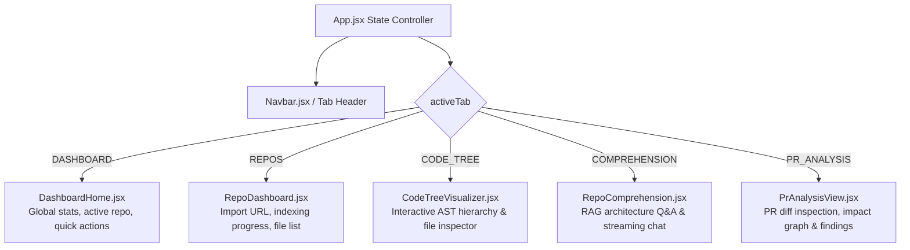

# Module 09: Frontend Architecture, Navigation & API Client

## 1. Frontend Technology Stack & Structure

The CodeSense frontend is a modern Single Page Application (SPA) built with:
- **Framework**: React 19 (`frontend/package.json`)
- **Bundler & Dev Server**: Vite 6 (`frontend/vite.config.js`)
- **Styling**: Vanilla CSS + Tailwind utility tokens (`frontend/src/index.css`)
- **Visual Identity**: Crimson Cyberpunk / Void palette (deep black `#070709`, crimson red `#E50914`, subtle glass borders)
- **Icons**: `lucide-react`
- **Real-Time Streaming**: Native Fetch API with `ReadableStream` decoder for Server-Sent Events (SSE).

---

## 2. Navigation Controller & Active Views

In `frontend/src/App.jsx`, navigation is managed through state-driven tab switching:



---

## 3. The Central API Client (`frontend/src/api.js`)

All communication between the React frontend and the Express backend is centralized in `frontend/src/api.js`. This prevents hardcoded URLs across UI components.

### Core API Methods:

```javascript
// Base URL configuration (defaults to Express backend port 8080)
const API_BASE = import.meta.env.VITE_API_BASE_URL || 'http://localhost:8080/api';

// Authentication
export const checkAuthStatus = () => apiFetch('/auth/me');
export const demoLogin = () => apiFetch('/auth/demo-login', { method: 'POST' });
export const logout = () => apiFetch('/auth/logout', { method: 'POST' });

// Repositories
export const fetchRepositories = () => apiFetch('/repos');
export const importRepository = (url) => apiFetch('/repos', { method: 'POST', body: JSON.stringify({ url }) });
export const getRepoStatus = (id) => apiFetch(`/repos/${encodeURIComponent(id)}/status`);
export const getRepoStructure = (id) => apiFetch(`/repos/${encodeURIComponent(id)}/structure`);

// Pull Requests
export const analyzePullRequest = (prUrl, repositoryId) => 
  apiFetch('/pull-requests/analyze', { method: 'POST', body: JSON.stringify({ prUrl, repositoryId }) });
export const getPrAnalysis = (analysisId) => apiFetch(`/pull-requests/${encodeURIComponent(analysisId)}`);
export const getPrImpact = (analysisId) => apiFetch(`/pull-requests/${encodeURIComponent(analysisId)}/impact`);
```

---

## 4. How SSE Streaming is Consumed in React

For RAG architecture chat, CodeSense uses `ReadableStream` instead of the traditional `EventSource` object to support custom POST bodies and auth headers:

```javascript
// frontend/src/api.js: lines 85-135
export async function streamChatMessage({ repositoryId, message, sessionId, onToken, onCitations, onDone, onError }) {
  const response = await fetch(`${API_BASE}/chat/message`, {
    method: 'POST',
    headers: { 'Content-Type': 'application/json' },
    credentials: 'include', // Sends signed session cookie
    body: JSON.stringify({ repositoryId, message, sessionId })
  });

  const reader = response.body.getReader();
  const decoder = new TextDecoder('utf-8');
  let buffer = '';

  while (true) {
    const { done, value } = await reader.read();
    if (done) break;

    buffer += decoder.decode(value, { stream: true });
    const lines = buffer.split('\n');
    buffer = lines.pop(); // Retain incomplete line

    for (const line of lines) {
      if (line.startsWith('data: ')) {
        const payload = JSON.parse(line.replace('data: ', '').trim());
        if (payload.type === 'citations') onCitations(payload.citations);
        if (payload.type === 'token') onToken(payload.token);
        if (payload.type === 'done') onDone();
      }
    }
  }
}
```

---

## 5. Real Backend Data vs. Demonstration Fallbacks

To ensure high usability during both live production operation and offline judging demonstrations, the frontend handles data gracefully:

1. **Live Backend Data (Primary Mode)**:
   - When the backend is running, all repository lists, indexing status bars, AST hierarchies, PR review cards, and chat streams reflect live database records from PostgreSQL.
2. **Demo Fallback Cards (Empty State Exploration)**:
   - In `PrAnalysisView.jsx` and `DashboardHome.jsx`, if no PR has been analyzed yet, the UI provides a `"Load Sample Review"` option.
   - This populates the view with a pre-configured multi-file pull request analysis (e.g., modifying `AuthService.ts` and affecting `CheckoutController.ts`), allowing users to explore the interactive impact tree and severity filters immediately.

---

## 6. End-to-End User Action Trace: Running a PR Review

Let us trace what occurs in the UI when a user analyzes a Pull Request:

1. **User Action**: The user pastes `https://github.com/expressjs/express/pull/5800` into `PrAnalysisView.jsx` and clicks `"Analyze PR"`.
2. **Immediate Feedback**:
   - The UI disables the submit button, displays an active progress spinner, and sets state to `status: 'ANALYZING'`.
3. **Backend Trigger**:
   - `api.analyzePullRequest(...)` sends a POST request to Express.
   - Backend returns `200 OK` with `{ id: "pr-5800-1719280000", status: "ANALYZING" }`.
4. **Polling for Results**:
   - `PrAnalysisView.jsx` sets an interval polling `api.getPrAnalysis(analysisId)` every 2 seconds.
5. **State Transition & Rendering**:
   - Once the backend completes AST mapping, caller tracing, and Gemini review, the status transitions to `'COMPLETED'`.
   - The UI fetches findings and impact records via `api.getPrImpact(analysisId)`.
   - The screen renders:
     - **Summary Banner**: Overall Result (`REQUEST_CHANGES`), Critical/High/Medium counters.
     - **Findings Panel**: Expandable severity cards with line ranges, impact explanations, and test recipes.
     - **Impact Tree Visualizer**: Interactive caller hierarchy showing `[CONFIRMED]` direct callers and `[TRANSITIVE]` downstream callers.

---

## 7. Five Short Questions to Test Your Understanding

1. Which file serves as the single source of truth for all frontend-to-backend HTTP requests?
2. Why does `streamChatMessage` use `fetch` with `ReadableStream` instead of standard `EventSource`?
3. What are the five primary navigation tabs in the application?
4. How does the frontend handle empty states when no PR has been analyzed yet?
5. What visual theme is implemented across the CodeSense UI?
