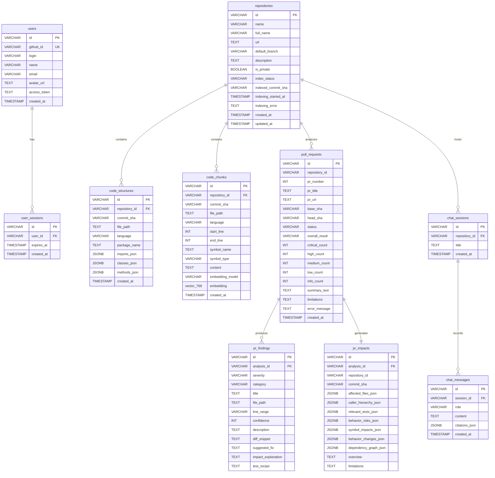

# Module 10: Database Schema, Relational Model & PGVector Storage

## 1. Relational Entity-Relationship Diagram (ERD)



---

## 2. Table Specifications & Column Definitions

### 1. `repositories`
Tracks indexed projects and their synchronization state.
- `id` (VARCHAR PK): Repository full name (e.g., `"expressjs/express"`).
- `index_status` (VARCHAR): `'PENDING' | 'INDEXING' | 'COMPLETED' | 'FAILED'`.
- `indexed_commit_sha` (VARCHAR): Git commit SHA at the time of indexing.
- `indexing_started_at` (TIMESTAMP): Used to identify and recover timed-out or hung jobs.
- `indexing_error` (TEXT): Detailed error stack trace if indexing fails.

### 2. `code_structures`
Stores the AST structural skeleton of the repository.
- `id` (VARCHAR PK): Composite `${repositoryId}:${filePath}`.
- `repository_id` (VARCHAR FK -> repositories.id ON DELETE CASCADE).
- `commit_sha` (VARCHAR): Revision commit SHA.
- `imports_json` (JSONB): Array of import paths and module specifiers.
- `classes_json` (JSONB): Array of declared classes, interfaces, and line ranges.
- `methods_json` (JSONB): Array of methods, signatures, line bounds, and called method names.

### 3. `code_chunks`
Stores text chunks and their high-dimensional vector embeddings.
- `id` (VARCHAR PK): Composite `${repositoryId}:${filePath}:${startLine}-${endLine}`.
- `repository_id` (VARCHAR FK -> repositories.id ON DELETE CASCADE).
- `commit_sha` (VARCHAR): Revision commit SHA.
- `symbol_name` (TEXT): Name of the AST symbol enclosing this chunk.
- `embedding` (`vector(768)`): 768-dimensional float array for cosine similarity queries.
- `embedding_model` (VARCHAR): Model used (`"gemini-embedding-2"`).

### 4. `pull_requests`
Master record for pull request review jobs.
- `id` (VARCHAR PK): Formatted as `pr-{number}-{timestamp}`.
- `status` (VARCHAR): `'PENDING' | 'ANALYZING' | 'COMPLETED' | 'FAILED'`.
- `overall_result` (VARCHAR): `'APPROVE' | 'REQUEST_CHANGES' | 'COMMENT'`.
- Severity counters: `critical_count`, `high_count`, `medium_count`, `low_count`, `info_count`.

### 5. `pr_findings`
Actionable review findings generated by Gemini and validated against the diff.
- `analysis_id` (VARCHAR FK -> pull_requests.id ON DELETE CASCADE).
- `severity` (VARCHAR): `'CRITICAL' | 'HIGH' | 'MEDIUM' | 'LOW' | 'INFO'`.
- `category` (VARCHAR): `'BREAKING_CHANGE' | 'SECURITY' | 'PERFORMANCE' | 'TEST_GAP'`.
- `line_range` (VARCHAR): Line reference in the diff (e.g., `"L45-L52"`).
- `suggested_fix` (TEXT): Actionable code replacement.
- `test_recipe` (TEXT): Generated unit test to catch regressions.

### 6. `pr_impacts`
Complete structural blast-radius and dependency graph.
- `caller_hierarchy_json` (JSONB): Array of confirmed, inferred, and transitive callers.
- `relevant_tests_json` (JSONB): Existing test suites exercising modified code.
- `behavior_risks_json` (JSONB): Structural risks and missing test gaps.
- `dependency_graph_json` (JSONB): Graph representation with nodes and edges.

---

## 3. Database Indexes & Performance Optimization

To handle low-latency querying on large repositories:

1. **Foreign Key Cascade Deletion**:
   Deleting a repository from `repositories` automatically cascades and deletes all associated records in `code_structures`, `code_chunks`, and `chat_sessions`.
2. **Composite Commit Indexes**:
   ```sql
   CREATE INDEX IF NOT EXISTS code_structures_repo_commit_idx ON code_structures(repository_id, commit_sha);
   CREATE INDEX IF NOT EXISTS code_chunks_repo_commit_idx ON code_chunks(repository_id, commit_sha);
   ```
   Enables sub-millisecond retrieval of ASTs and vector chunks partitioned by commit revision.
3. **HNSW Cosine Vector Index**:
   ```sql
   CREATE INDEX IF NOT EXISTS code_chunks_embedding_hnsw_idx 
   ON code_chunks USING hnsw (embedding vector_cosine_ops);
   ```
   Uses graph-based approximate nearest neighbor search to perform cosine queries in logarithmic time.

---

## 4. Vector Dimension Migration Strategy

In `server/src/db/pgvector.ts`:

A major challenge in vector databases is switching embedding providers (e.g., from Voyage 1536 dims to Gemini 768 dims). If the vector column dimension does not match the active model, PostgreSQL throws an error.

CodeSense implements **dynamic vector migration** on startup:

```typescript
// server/src/db/pgvector.ts: lines 195-210
const dimCheck = await client.query(`
  SELECT format_type(atttypid, atttypmod) as col_type
  FROM pg_attribute
  WHERE attrelid = 'code_chunks'::regclass AND attname = 'embedding';
`);
if (dimCheck.rows.length > 0) {
  const currentType = dimCheck.rows[0].col_type;
  const targetType = `vector(${dim})`; // vector(768)
  if (currentType && currentType !== targetType && currentType.startsWith('vector')) {
    console.log(`🔄 Migrating embedding column from ${currentType} to ${targetType}...`);
    await client.query(`UPDATE code_chunks SET embedding = NULL;`);
    await client.query(`ALTER TABLE code_chunks ALTER COLUMN embedding TYPE vector(${dim});`);
    console.log(`✅ Embedding column migrated to ${targetType}.`);
  }
}
```

---

## 5. Five Short Questions to Test Your Understanding

1. What happens to the records in `code_chunks` when a repository is deleted from `repositories`?
2. What composite index accelerates lookups of AST structures for a specific commit revision?
3. What data is stored in the `imports_json` column of `code_structures`?
4. How does CodeSense prevent dimension mismatch errors when switching between 768 and 1536 dimension embedding models?
5. Which table stores actionable unit test recipes generated during PR analysis?
